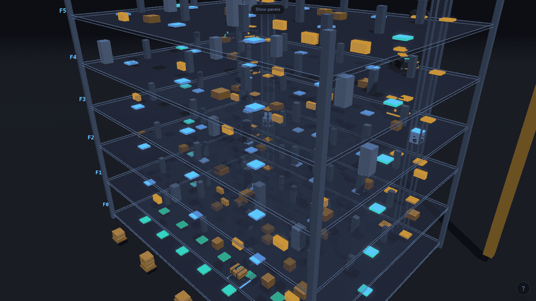

# MAPF Fleet — Multi-robot path planning for multi-floor sites, with a 3D simulator

[](https://github.com/hurjun/mapf-fleet/actions/workflows/ci.yml)
[](https://mapf-fleet.vercel.app/)

MAPF Fleet is a from-scratch TypeScript engine for multi-agent path finding (MAPF: many robots, no collisions). It routes a robot fleet across a multi-floor construction site with capacity-limited elevators. A 3D web app shows the fleet live; a headless benchmark stress-tests the same engine across seeds and sites.

**Live demo:** [mapf-fleet.vercel.app](https://mapf-fleet.vercel.app/) — orbit, then change site and fleet live.



*A ~6-second loop recorded from the running app in headless Chromium ([`scripts/record-gif.mjs`](scripts/record-gif.mjs)).*

## Result

Headless benchmark (`npm run bench`), node v20.11.0, Apple M2, `vite-node`. Full tables: [docs/DETAILS.md](docs/DETAILS.md).

- **0 collisions** across 66 runs (3 sites × 6 fleet sizes × 3 seeds, plus 12 CBS-comparison runs). Invariant re-checked every tick.
- 18,600 timed ticks; 21,240 including the collision-checked 40-tick warm-up per run. Every run stayed live.
- Prioritized WHCA\* plans in 0.75–21.5 ms/tick for 2–16 robots.
- Optimal CBS gives the same throughput (6.5 deliveries/min, factory, 12 robots) at up to ~9× the cost: 13.5 vs 123.8 ms/tick.
- The 6-floor apartment plateaus near ~4.7 deliveries/min while average wait climbs from 17.6 to 101.5 ticks: the elevator-capacity regime the fleet-size model predicts.


**Research link.** A small, reproducible case of simulation-based validation. A safety invariant is checked every tick across seeds. A throughput model is checked against measured data. A known failure mode (planner deadlock) is recovered and counted. I want to extend it to fault diagnosis and failure prediction for real cyber-physical fleets.

## How it works

- Each floor is a 2D grid linked by elevators. Obstacles are impassable cells; a connectivity guard keeps every station reachable.
- Each robot plans with windowed space-time A\* (WHCA\*) against a shared reservation table; order-independent edge keys block head-on swaps.
- Robots plan in priority order (loaded first, then longest-waiting). A blocked robot holds its cell: that is yielding.
- Optional CBS (Conflict-Based Search): find the first conflict, branch, replan one robot. Past a per-floor node budget (search-size cap), prioritized planning takes over.
- Elevators run a LOOK scan (keep direction while stops lie ahead, else reverse) with limited capacity; battery and chargers are real constraints.
- An analytical fleet-size model (floor congestion + elevator capacity) predicts throughput, overlaid on measured values.

## Run it

```bash
npm install
npm run dev         # open http://localhost:3000
npm run test:run    # unit tests
npm run bench       # benchmark; rewrites docs/benchmark.json
```

**Tests:** 40 Vitest tests in 8 files; one full-simulation test asserts the collision-free invariant every tick on all three sites. CI runs lint, typecheck, tests, build.

## Limitations

- Robots are single-cell and uniform-speed.
- CBS is optimal only per window, within the node budget; past it, the prioritized planner takes over.
- The prioritized planner alone is incomplete: it can deadlock on tightly coupled instances. A heuristic priority shuffle recovers; CBS removes the failure mode.
- Task assignment is greedy under uniform demand. Optimizer traffic constants are hand-tuned, not calibrated from data.
- Not implemented: heterogeneous robots, ECBS (bounded-suboptimal CBS), deadline-aware tasks, optimizer auto-calibration.

## More

- [Details](docs/DETAILS.md): benchmark tables, feature list, long how-it-works, UI tour, site gallery, tech stack, layout, deployment.
- [ALGORITHMS.md](ALGORITHMS.md): state space, reservation table, WHCA\*, CBS, complexity notes, worked example.
- References: Silver 2005, Sharon et al. 2015, Stern et al. 2019 (in both files).

## License

Released under the [MIT License](LICENSE).

— Jun Hur · [portfolio](https://hurjun.github.io) · [KCC 2024 paper](https://hurjun.github.io/asset/kcc2024-kiise-nursing-record-paper.pdf) · hurjun96@gmail.com
