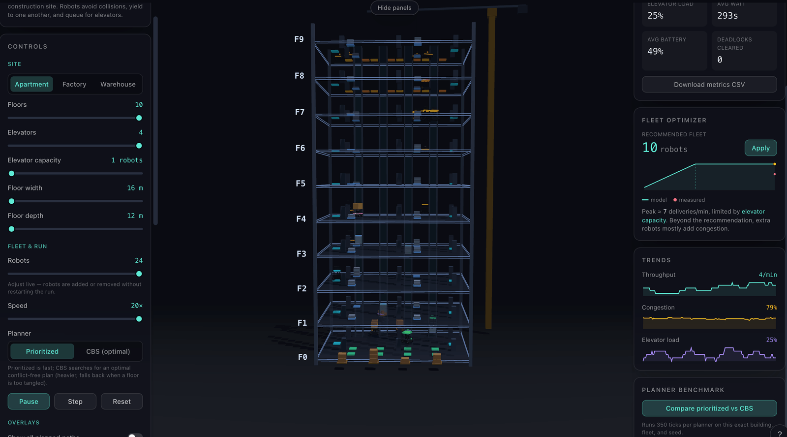
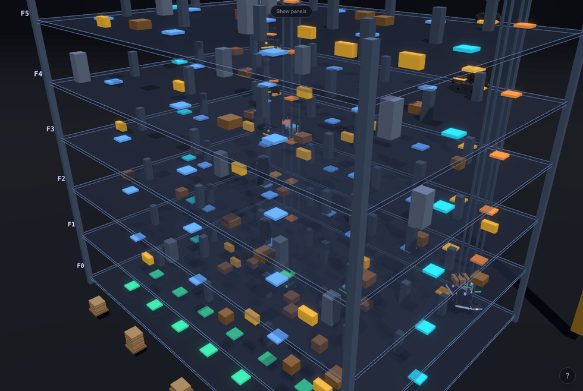
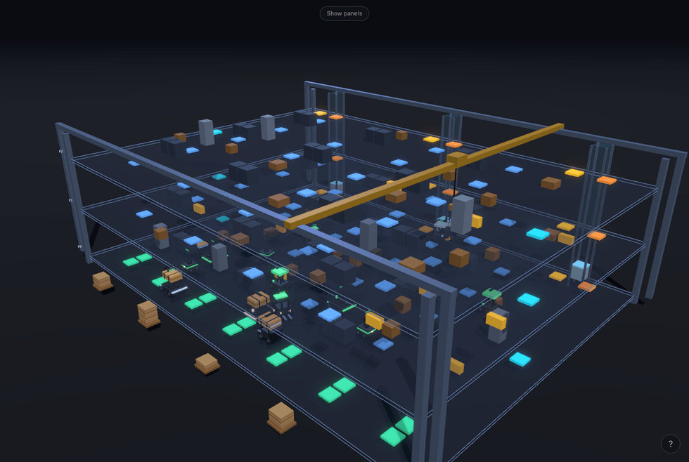
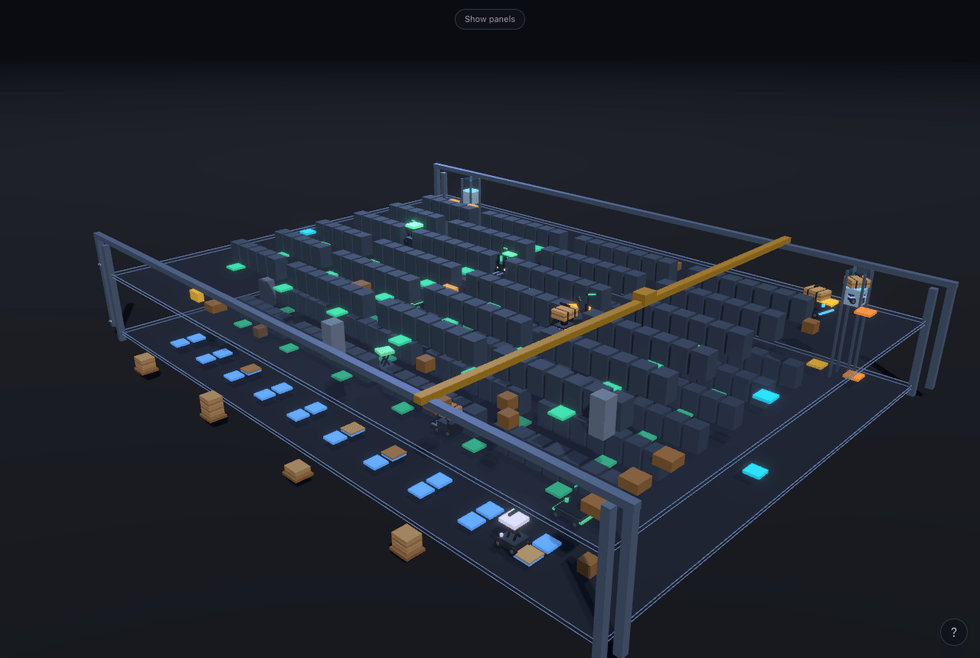
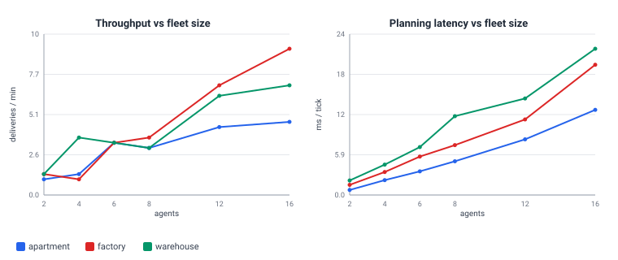
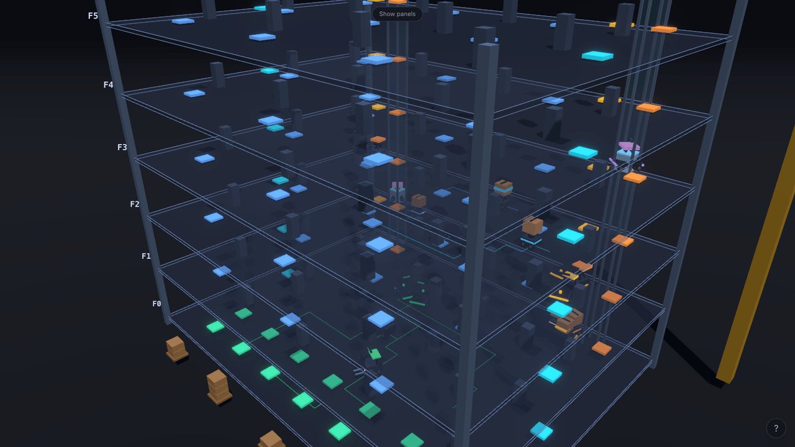

# MAPF Fleet — Details

Long-form material moved out of the main [README](../README.md): the full
benchmark tables, the feature list, the long "how it works" walkthrough, the UI
tour, the tech stack, the project layout, deployment notes, and references.
The algorithm write-up with a worked example lives in
[ALGORITHMS.md](../ALGORITHMS.md).

Benchmark numbers reproduce from [`benchmark.json`](benchmark.json)
(`npm run bench`); test counts come from `src/sim/*.test.ts`.

---

## The interface



Captured from the running app. **Left** — configure the site, fleet, planner,
and speed, all adjustable while the simulation runs. **Centre** — a
clearly-stacked tower (here a 10-floor apartment) you can orbit, pan, and zoom.
**Right** — live metrics, the fleet-size optimizer with its model-vs-measured
throughput curve, live trend charts, and a one-click prioritized-vs-CBS
benchmark.

---

## Three sites, one engine

The same framework-free MAPF engine drives three procedurally-generated site
types. Switch between them live from the **Site** tabs; no restart is needed.

<table>
<tr>
<td width="33%" valign="top"><br><b>Apartment</b><br>A tall high-rise: every job crosses floors, so the capacity-limited elevators become the bottleneck.</td>
<td width="33%" valign="top"><br><b>Factory</b><br>A wide, low multi-floor hall under a gantry crane — traffic spreads across the floor.</td>
<td width="33%" valign="top"><br><b>Warehouse</b><br>Dense storage aisles feeding shipping docks on a two-floor footprint.</td>
</tr>
</table>

Frames from the running app, UI panels hidden. Regenerate with
[`scripts/screenshot-sites.mjs`](../scripts/screenshot-sites.mjs).

---

## Feature list

- **Real multi-agent path finding.** A prioritized planner runs a *windowed
  cooperative space-time A\** (WHCA\*) for every robot against a shared
  reservation table. Robots never collide or swap places head-on; yielding and
  queuing come from the planner, not from scripts.
- **Three switchable sites.** A tall **apartment** high-rise (every job crosses
  floors, so the elevators dominate), a wide multi-floor **factory**, and a
  **warehouse** of storage aisles feeding shipping docks — same engine, different
  layouts.
- **Two planners, switchable live.** The fast prioritized planner, or
  **Conflict-Based Search (CBS)** — an optimal MAPF algorithm — toggled from the
  UI without restarting the run.
- **Capacity-limited elevators with queues.** Each car runs a LOOK-style
  scheduler; robots form a visible line at the boarding pad and the car fills to
  capacity before departing.
- **Battery and charging stations.** Robots drain a battery as they work, divert
  to a free charger when low, recharge, and resume — a real capacity-limited
  scheduling constraint, shown with per-robot battery bars.
- **Reads like a construction site.** Floors are clearly stacked, outlined decks
  tied together by a steel frame with floor labels. Every level is dressed with
  obstacles — concrete pillars, machinery, racks, scaffolding, hazard barriers,
  and pallets of staged flooring — that the fleet weaves around. Robots ferry
  bundles of engineered-wood flooring planks, and the installed flooring
  accumulates tile by tile at each delivery point. A tower crane (apartment) or
  gantry crane (factory/warehouse) stands over the staged material; elevator
  cars travel lit shafts.
- **Live fleet-size optimizer with model-vs-reality overlay.** An analytical
  throughput model — derived from the *actual* generated layout — predicts
  deliveries/minute vs. fleet size, recommends a deployment, and names the
  binding bottleneck. The measured throughput from the running simulation is
  plotted right on top of the prediction.
- **Inspect and visualize.** Click any robot for a live inspector and its
  planned path; toggle all paths to watch the planner coordinate the fleet; read
  a 2D floor minimap, live trend charts, camera presets, and a single-floor focus
  mode — with optional bloom.
- **Configure everything live.** Floors, elevator count and capacity, floor
  size, fleet size, planner, and speed are all adjustable while the simulation
  runs — robots are added or removed without restarting.
- **Readable at a glance.** Robots are detailed per-kind models color-coded by
  state (heading to a pickup, carrying, yielding, waiting for a lift, riding,
  charging).

---

## How it works (long version)

The simulation engine (`src/sim/`) is pure, framework-free TypeScript with no
rendering or DOM dependencies, so it runs identically in unit tests and in the
browser. The 3D scene and UI (`src/three/`, `src/components/`) are a thin,
reactive layer on top of it.

### World model

The site is a stack of 2D grids — one per floor — connected by elevators. Each
cell is free space, a wall, or an elevator boarding/exit pad. Walls cover both
the permanent structure and a deterministic scatter of **site obstacles**
(pillars, machinery, racks, scaffolding, barriers, pallets, crates). Each carries
a render-only *kind* tag that drives its 3D prop, but to the planner they are all
the same impassable cell. A connectivity guard guarantees the scatter never
walls off a station or pad. Pickup and dropoff stations sit on walkable cells.
The three scenarios are produced procedurally by `scenarios.ts`.

### Path finding (the MAPF core)

[ALGORITHMS.md](../ALGORITHMS.md) walks through the `(x, y, t)` state space,
the space-time reservation table, WHCA\*, and CBS in depth — with complexity
notes, a reproducible worked example, and references.

Robots navigate with a **prioritized, cooperative** scheme:

1. **Single-agent search** — `spaceTimeAStar` plans in the `(x, y, t)`
   state space over a short time window. Cells and transitions that
   higher-priority robots have already reserved count as obstacles. If the goal
   is beyond the window it returns the path to the closest reachable cell, so
   the robot always makes progress (classic WHCA\*).
2. **Reservation table** — `reservation.ts` records the cells (vertices) and
   moves (edges) each robot will occupy. Edge keys are order-independent, which
   is what blocks two robots from swapping places head-on.
3. **Prioritized planning** — `planner.ts` plans robots in priority order
   (loaded first, then whoever has waited longest, breaking stand-offs over
   time). A robot that cannot make progress simply holds position — that is the
   **yielding** you see. Only the very next step is ever executed. The planner
   also reserves each not-yet-planned robot's current cell for the next tick,
   which **guarantees no two robots ever land on the same cell**.

The **CBS** planner (`cbs.ts`) can be selected at runtime instead. It is a
two-level search. The high level is a best-first search over a binary
*constraint tree*: it finds the first vertex/edge conflict between two agents,
branches, and forbids one agent from it. The low level is a constrained
space-time A\* that replans just that agent. CBS runs per floor over the window
with a node budget. If a floor cannot be resolved in budget it falls back to the
prioritized planner, so the app stays real-time and never stalls.

### Elevators

`elevator.ts` models each car as a capacity-limited transport running a
**LOOK scan**: keep moving in the current direction while there is a stop to
serve ahead (a rider's destination, or a floor with a waiting robot), otherwise
reverse, otherwise idle. A full car ignores hall calls and heads straight for
its riders' destinations. The shaft sits *between* the boarding and exit pads so
the boarding queue can never block an exit — a small but important
deadlock-avoidance detail.

### Battery and charging

Each robot drains a battery as it works (faster while carrying). When it drops
below a threshold it claims the nearest free charger on its floor, drives there,
recharges, and resumes. Chargers hold one robot at a time, so charging is a
real scheduling constraint rather than a cosmetic detail. The optimizer folds
the resulting charging duty cycle into an **availability factor** so its
prediction stays aligned with the simulation.

### Fleet-size optimizer

`optimize.ts` answers "how many robots should I deploy?" It builds the world to
measure real free space and the true pickup/dropoff-to-elevator distances (via
reverse-BFS distance fields), then combines:

- a **floor-congestion** model (a traffic "fundamental diagram": robots slow as
  density rises), and
- an **elevator-capacity ceiling** (boardings served per round trip).

Sweeping the fleet size yields the throughput curve. Its knee is the
**recommended** fleet (the smallest one within 95% of the peak), and the binding
term identifies the **bottleneck**. The full derivation is documented inline in
`optimize.ts`. As the simulation runs, the measured throughput at each fleet
size is recorded and drawn as points over the predicted curve — model versus
reality, side by side.

---

## What's implemented (and what isn't)

**Implemented from scratch:**

- A\* and a **windowed cooperative space-time A\*** (WHCA\*) over `(x, y, t)`.
- A **space-time reservation table** with order-independent edge keys, which is
  what blocks head-on swaps.
- A **prioritized planner** whose next-step reservation discipline guarantees no
  two robots ever land on the same cell.
- **Conflict-Based Search** (two-level constraint-tree search, vertex *and* edge
  conflicts, constrained low-level replanning).
- Capacity-limited **elevators** (LOOK scheduler), **battery/charging** as a real
  scheduling constraint, and procedural **apartment / factory / warehouse** worlds.
- An analytical **fleet-size optimizer** checked live against the simulation.
- A **deterministic, seeded** engine with unit tests asserting the collision-free
  invariant on every tick.

**Simplifications and non-goals (by design):**

- Robots are **single-cell and uniform-speed** — no heterogeneous footprints or
  speeds.
- CBS runs on a **rolling window with a per-floor node budget** and **falls back
  to the prioritized planner** when a floor cannot be resolved in budget. Its
  optimality is *per-window, within budget*. It is a real-time planner, not a
  full offline optimal solver over the whole episode.
- The prioritized planner alone is **incomplete** (it can deadlock on tightly
  coupled instances). The engine recovers with a heuristic priority-shuffle, and
  CBS removes the failure mode. See the worked example in
  [ALGORITHMS.md](../ALGORITHMS.md).
- Task assignment is **greedy under uniform demand** — no deadlines or priorities.
- The optimizer's traffic constants (jam density, min speed) are **hand-tuned,
  not calibrated** from data.

---

## Performance and scaling (full tables)

A headless benchmark ([`scripts/benchmark.ts`](../scripts/benchmark.ts), driven
by the pure library in [`src/sim/scaling.ts`](../src/sim/scaling.ts)) drives the
**real engine** — no rendering — across fleet sizes, scenarios, and seeds. For
each run it times only the per-tick `Engine.step()` call (dominated by the
multi-agent planner), records delivery throughput and coordination quality, and
**re-checks the collision-free invariant on every tick**, including the
warm-up. Reproduce it with `npm run bench`; it regenerates the figure below and
[`benchmark.json`](benchmark.json).



Each row below averages **3 seeds × 300 timed ticks** (plus a 40-tick warm-up
per run) under the prioritized WHCA\* planner. *Planning* is the mean wall-clock
time per tick; *Success* is the fraction of seeds that stayed collision-free and
live.

**apartment** — 6 floors, 24×18, 2 elevators (cap 2):

| Agents | Throughput (del/min) | Planning (ms/tick) | Avg wait (ticks) | Congestion | Collisions | Success |
| -----: | -------------------: | -----------------: | ---------------: | ---------: | ---------: | ------: |
| 2 | 1.0 | 0.75 | 17.6 | 0% | 0 | 100% |
| 4 | 1.3 | 2.19 | 23.2 | 0% | 0 | 100% |
| 6 | 3.3 | 3.47 | 25.5 | 28% | 0 | 100% |
| 8 | 3.0 | 4.96 | 36.5 | 25% | 0 | 100% |
| 12 | 4.3 | 8.18 | 66.5 | 44% | 0 | 100% |
| 16 | 4.7 | 12.52 | 101.5 | 46% | 0 | 100% |

**factory** — 3 floors, 30×22, 3 elevators (cap 3):

| Agents | Throughput (del/min) | Planning (ms/tick) | Avg wait (ticks) | Congestion | Collisions | Success |
| -----: | -------------------: | -----------------: | ---------------: | ---------: | ---------: | ------: |
| 2 | 1.3 | 1.49 | 5.5 | 17% | 0 | 100% |
| 4 | 1.0 | 3.38 | 9.0 | 0% | 0 | 100% |
| 6 | 3.3 | 5.65 | 8.9 | 11% | 0 | 100% |
| 8 | 3.7 | 7.33 | 10.0 | 4% | 0 | 100% |
| 12 | 7.0 | 11.11 | 10.8 | 22% | 0 | 100% |
| 16 | 9.3 | 19.15 | 12.5 | 2% | 0 | 100% |

**warehouse** — 2 floors, 36×26, 2 elevators (cap 3):

| Agents | Throughput (del/min) | Planning (ms/tick) | Avg wait (ticks) | Congestion | Collisions | Success |
| -----: | -------------------: | -----------------: | ---------------: | ---------: | ---------: | ------: |
| 2 | 1.3 | 2.14 | 4.3 | 0% | 0 | 100% |
| 4 | 3.7 | 4.47 | 3.1 | 0% | 0 | 100% |
| 6 | 3.3 | 7.05 | 3.0 | 6% | 0 | 100% |
| 8 | 3.0 | 11.59 | 46.7 | 50% | 0 | 100% |
| 12 | 6.3 | 14.19 | 13.3 | 0% | 0 | 100% |
| 16 | 7.0 | 21.50 | 24.0 | 25% | 0 | 100% |

**Prioritized WHCA\* vs optimal CBS** (factory, 2 seeds × 200 ticks):

| Agents | Planner | Throughput (del/min) | Planning (ms/tick) | Avg wait (ticks) | Congestion |
| -----: | ------- | -------------------: | -----------------: | ---------------: | ---------: |
| 4 | prioritized | 1.5 | 4.11 | 10.5 | 0% |
| 4 | cbs | 1.5 | 5.39 | 10.5 | 0% |
| 8 | prioritized | 5.0 | 10.02 | 10.5 | 25% |
| 8 | cbs | 5.0 | 34.85 | 10.4 | 25% |
| 12 | prioritized | 6.5 | 13.50 | 13.9 | 13% |
| 12 | cbs | 6.5 | 123.82 | 14.1 | 13% |

### What the numbers show

- **Collision-free at scale.** Across all 66 runs (54 sweep runs + 12
  comparison runs) the per-tick check found **zero** collisions and every run
  stayed live. That is **18,600 timed ticks** (54 × 300 + 12 × 200), or
  **21,240 ticks** including the collision-checked 40-tick warm-up per run. The
  warm-up is not stored in `benchmark.json`, so the JSON `ticks` fields sum to
  18,600. This is the same invariant the unit tests check, now across many seeds
  and all three sites.
- **Throughput saturates, and the shape names the bottleneck.** The tall
  apartment (6 floors / 2 small elevators) plateaus near ~4.7 del/min while its
  average wait climbs from 17.6 to 101.5 ticks. Robots queue for the lift —
  exactly the elevator-capacity regime the fleet-size optimizer predicts. The
  flatter factory and warehouse keep scaling (factory reaches 9.3 del/min at 16
  agents).
- **Planning stays real-time.** Prioritized WHCA\* costs sub-millisecond to
  ~20 ms/tick up to 16 agents (0.75–21.50 ms/tick in the tables), growing a bit
  faster than linearly with fleet size (each added agent both plans and is
  planned around).
- **The classic MAPF trade-off, measured.** On these loosely-coupled floors the
  prioritized planner is already near-optimal. Optimal **CBS matches its
  throughput and wait but costs up to ~9× the compute** (factory, 12 agents:
  13.5 vs 123.8 ms/tick; a single hard seed pushed CBS past 200 ms/tick,
  218.2 ms/tick on seed 2). CBS earns its keep only on tightly-coupled
  instances; that is why it ships as an *option* with a node-budget fallback,
  not the default.

Numbers are from `node v20.11.0` on an Apple M2 (benchmark date 2026-06-27),
executing the TypeScript engine directly via `vite-node`; a production bundle
runs faster. The machine-independent story is the *shape* of each curve and the
prioritized-vs-CBS ratio. Full per-seed data is in
[`benchmark.json`](benchmark.json).

---

## Exploring the simulation



Panels hidden (<kbd>U</kbd>) with every robot's planned path overlaid
(<kbd>P</kbd>). Regenerate with
[`scripts/screenshot.mjs`](../scripts/screenshot.mjs); the hero GIF (a
~6-second loop) comes from
[`scripts/record-gif.mjs`](../scripts/record-gif.mjs) (headless Chromium,
SwiftShader WebGL).

- **Click a robot** to select it: a halo marks it, its planned path is drawn, and
  an inspector shows its live status, battery, task, and plan.
- **Show all planned paths** to see the whole fleet's coordinated plans at once.
- **Floor minimap** gives a 2D top-down plan; clicking a dot selects that robot.
- **Trends** charts plot throughput, congestion, and elevator load over time.
- **Camera presets** (iso / top / side) and **single-floor focus** isolate a
  level for close inspection.
- **Congestion heatmap** highlights where the fleet stalls (elevator queues,
  pinch points).
- **Planner toggle** switches prioritized ↔ CBS live; **Glow** toggles bloom.
- **Step mode + keyboard shortcuts** (Space, S, P, F, 1/2/3, arrows, [ / ], Esc).
- **Shareable URL**: the configuration lives in the query string; **Download CSV**
  exports the run's metric history.

---

## Tech stack

| Layer        | Technology                                            |
| ------------ | ----------------------------------------------------- |
| Framework    | Next.js 14 (App Router), React 18, TypeScript (strict) |
| 3D rendering | three.js via React Three Fiber + drei                 |
| State        | Zustand                                               |
| Styling      | Tailwind CSS                                          |
| Testing      | Vitest                                                |
| Hosting      | Vercel                                                |

## Project structure

```
src/
├── sim/                 # framework-free simulation engine (unit-tested)
│   ├── types.ts         # core domain types
│   ├── grid.ts          # walkability, neighbours, BFS distance fields
│   ├── astar.ts         # A* and windowed space-time A* (WHCA*)
│   ├── reservation.ts   # space-time reservation table
│   ├── planner.ts       # prioritized multi-agent planner
│   ├── cbs.ts           # Conflict-Based Search (optimal) planner
│   ├── elevator.ts      # elevator car + LOOK scheduler
│   ├── engine.ts        # tasks, robot state machine, battery, tick loop
│   ├── scenarios.ts     # apartment / factory / warehouse world generators
│   ├── scaling.ts       # headless benchmark library (used by npm run bench)
│   └── optimize.ts      # analytical fleet-size optimizer
├── state/               # Zustand store + real-time tick loop
├── three/               # R3F scene: building, fleet, elevators, paths, bloom
├── components/          # control / metrics / optimizer / inspector / minimap UI
└── app/                 # Next.js app-router entry
```

## Scripts and tests

```bash
npm install
npm run dev         # open http://localhost:3000
npm run build       # production build
npm test            # run the engine unit tests (watch)
npm run test:run    # run the unit tests once
npm run lint        # lint
npm run typecheck   # tsc --noEmit
npm run bench       # headless benchmark; regenerates docs/benchmark.json and the SVG
```

**Tests:** 40 Vitest unit tests across 8 files (astar 7, elevator 3, engine 6,
cbs 5, grid 4, reservation 4, planner 4, optimize 7). The engine test asserts
the **collision-free invariant on every tick** and that cross-floor deliveries
complete end-to-end on all three sites (apartment, factory, warehouse).
CI (`.github/workflows/ci.yml`) runs lint, typecheck, tests, and the production
build on every push and pull request to `main`.

## Deployment (Vercel)

A live instance is deployed at [mapf-fleet.vercel.app](https://mapf-fleet.vercel.app/).

The project is a standard Next.js app and deploys to Vercel with zero
configuration:

1. Push this repository to GitHub.
2. Import it at [vercel.com/new](https://vercel.com/new) — Vercel auto-detects
   Next.js.
3. Deploy. No environment variables are required.

## Not implemented (possible extensions)

- Heterogeneous robot speeds and footprints (multi-cell robots).
- Auto-calibrating the optimizer's constants from the measured points.
- Priority/deadline-aware task assignment instead of unlimited uniform demand.
- Bounded-suboptimal CBS variants (ECBS) for larger fleets.

## References

The planners follow the primary MAPF literature; the full list with complexity
notes is in [ALGORITHMS.md](../ALGORITHMS.md). Key sources:

- D. Silver. *Cooperative Pathfinding.* AIIDE, 2005. — Windowed Hierarchical
  Cooperative A\* (WHCA\*), the basis of the prioritized planner.
- G. Sharon, R. Stern, A. Felner, N. R. Sturtevant. *Conflict-Based Search for
  Optimal Multi-Agent Pathfinding.* Artificial Intelligence 219 (2015), 40–66. —
  the CBS planner.
- R. Stern et al. *Multi-Agent Pathfinding: Definitions, Variants, and
  Benchmarks.* SoCS, 2019. — vertex/edge/swap conflict terminology.

---

Written by Jun Hur. Released under the [MIT License](../LICENSE).
